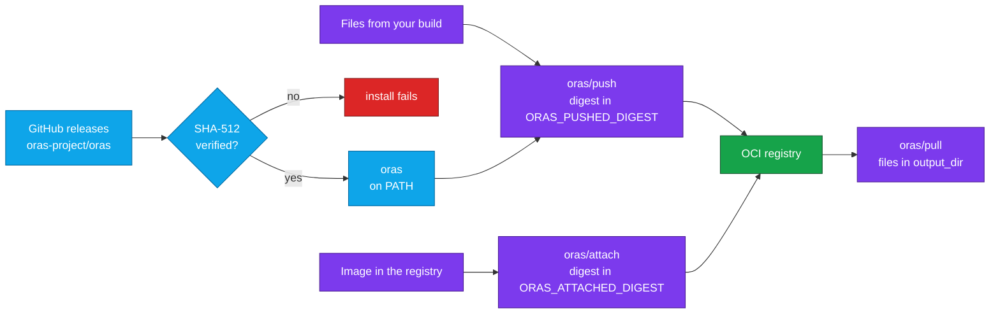

<div align="center">


# ORAS for CircleCI and GitHub Actions

### Push, pull and attach OCI artifacts in your registry, from CircleCI or GitHub Actions.

Install a checksum-verified [ORAS](https://oras.land) and store any file in a container registry, with orb commands or GitHub Actions:<br>
reports, SBOMs, signatures and build outputs, pushed on their own or attached to an image.<br>
Strict SHA-512 verification by default · No `sudo` · Passwords never on the command line

[](https://circleci.com/gh/juburr/oras-orb)
[](https://github.com/juburr/oras-orb/actions/workflows/actions.yml)
[](https://circleci.com/developer/orbs/orb/juburr/oras-orb)
[](LICENSE)
[](https://discuss.circleci.com/c/ecosystem/orbs)


**[Quick Start](#-quick-start)** · **[Features](#-why-oras-orb)** · **[Recipes](#-recipes)** · **[Commands](#-commands)** · **[GitHub Actions](#-github-actions)** · **[Security](#-secure-by-design)** · **[Network Access](#-network-access)**

<sub>An unofficial, community-maintained CircleCI orb and set of GitHub Actions. [Contributions are welcome!](#-contributing)</sub>

</div>

<br>

## ✨ Why oras-orb?

<table>
<tr>
<td width="33%" valign="top">
📦 <b>Any file, in the registry you already run</b><br><br>
<code>push</code> stores reports, SBOMs and build outputs as an OCI artifact next to your images, and <code>pull</code> brings them back in a later job or pipeline. No separate artifact store to run.
</td>
<td width="33%" valign="top">
📎 <b>Attach evidence to an image</b><br><br>
<code>attach</code> links an SBOM, a scan report or a signature to an image by its digest, so <code>oras discover</code> finds it from the image itself.
</td>
<td width="33%" valign="top">
🔗 <b>Digests for later steps</b><br><br>
<code>push</code> and <code>attach</code> export the digest of the manifest they pushed, as <code>ORAS_PUSHED_DIGEST</code> and <code>ORAS_ATTACHED_DIGEST</code>, so later steps can pull, attach to or sign exactly that artifact.
</td>
</tr>
<tr>
<td width="33%" valign="top">
🔐 <b>Verified installs, fail-closed by default</b><br><br>
By default, every ORAS binary is checked against a SHA-512 table built into the orb, and versions it can't verify are refused, not run. <a href="#-checksum-verification">Opt-outs</a> are explicit.
</td>
<td width="33%" valign="top">
🔑 <b>Secrets stay off the command line</b><br><br>
Credential parameters name environment variables. The password reaches ORAS on stdin, so it never shows up in a process listing or the step log, even with xtrace on.
</td>
<td width="33%" valign="top">
🦾 <b>amd64 and arm64</b><br><br>
Picks the right ORAS build for x86_64 executors and CircleCI Arm resource classes, cached per version and architecture.
</td>
</tr>
</table>

### 🧩 The Orb vs. a Hand-Rolled Script

| | Scripting ORAS yourself | With the orb |
| --- | --- | --- |
| **Installing ORAS** | Download the release from GitHub, check it against the release's checksums, extract it, and put `oras` on the `PATH` | `oras/install` checks the binary against a built-in SHA-512 for amd64 and arm64, fails closed on unknown versions, caches the release, and adds `install_path` to the `PATH` when it isn't there |
| **Registry login** | Pipe the password to `oras login --password-stdin`, and keep a traced step from printing it | `login` reads the variables you name and does both |
| **Getting the pushed digest** | Parse the push output, or fetch the manifest again and hash it | `push` and `attach` export it, shell-quoted, through `BASH_ENV` |
| **Passing lists of files and annotations** | Build the argument list by hand, quoting paths with spaces and annotations with commas | `files` splits like shell words and `annotations` takes one `key=value` per line, and nothing in either is run as shell code |

## 🔄 How It Works



`oras/install` downloads ORAS straight from the [ORAS project's GitHub releases](https://github.com/oras-project/oras/releases), verifies the SHA-512 checksum of its `oras` binary in the default `strict` mode shown here, and puts it on `PATH`. See [Checksum Verification](#-checksum-verification) for the other modes. `oras/login` stores credentials for a registry, `oras/push` sends files there as an artifact, `oras/pull` fetches them back, and `oras/attach` adds files to an image or artifact that is already there. `oras/logout` removes the credentials when the job is done with them.

## 🚀 Quick Start

### CircleCI

Add the orb, install ORAS, push your files. Copy this into `.circleci/config.yml`:

```yaml
version: 2.1

orbs:
  oras: juburr/oras-orb@0.2.0

jobs:
  publish_reports:
    docker:
      - image: cimg/base:current-22.04
    steps:
      - checkout
      - run:
          name: Build Reports
          command: mkdir -p reports && echo "all tests passed" > reports/tests.txt
      - oras/install:
          version: "1.3.5"
      # Reads the credentials from REGISTRY_USERNAME and REGISTRY_PASSWORD.
      - oras/login:
          registry: ghcr.io
      - oras/push:
          reference: ghcr.io/my-org/myapp-reports:${CIRCLE_SHA1}
          files: reports/tests.txt
          artifact_type: application/vnd.my-org.reports.v1
      - oras/logout:
          registry: ghcr.io

workflows:
  publish:
    jobs:
      - publish_reports:
          context: registry-credentials
```

Swap in your registry, repository and files, put `REGISTRY_USERNAME` and `REGISTRY_PASSWORD` in the `registry-credentials` context (for GHCR, your GitHub username and a token that can write packages), and push. ORAS stores each file under the path you give, relative to `working_dir`, so `oras pull ghcr.io/my-org/myapp-reports:<commit SHA>`, or the `pull` command, recreates `reports/tests.txt`. The digest of what was pushed is in `ORAS_PUSHED_DIGEST` for the rest of the job.

### GitHub Actions

```yaml
name: Publish Reports

on: push

permissions:
  contents: read
  packages: write

jobs:
  publish-reports:
    runs-on: ubuntu-24.04
    steps:
      - uses: actions/checkout@v7
      - name: Build reports
        run: mkdir -p reports && echo "all tests passed" > reports/tests.txt
      - uses: juburr/oras-orb/actions/install@v0.2.0
        with:
          version: "1.3.5"
      # Reads the credentials from REGISTRY_USERNAME and REGISTRY_PASSWORD.
      - uses: juburr/oras-orb/actions/login@v0.2.0
        env:
          REGISTRY_USERNAME: ${{ github.actor }}
          REGISTRY_PASSWORD: ${{ secrets.GITHUB_TOKEN }}
        with:
          registry: ghcr.io
      - uses: juburr/oras-orb/actions/push@v0.2.0
        with:
          reference: ghcr.io/my-org/myapp-reports:${{ github.sha }}
          files: reports/tests.txt
          artifact_type: application/vnd.my-org.reports.v1
      - uses: juburr/oras-orb/actions/logout@v0.2.0
        if: always()
        with:
          registry: ghcr.io
```

The job's `GITHUB_TOKEN` can push to GHCR with `packages: write`. The digest of what was pushed is in `ORAS_PUSHED_DIGEST` for the rest of the job. See [GitHub Actions](#-github-actions) for how the actions map to the orb's commands.

> [!IMPORTANT]
> This orb is at 0.x, so a minor release may still change a command or parameter. Pin the orb version, and the ORAS `version` as shown, so neither changes until you decide.

## 🍳 Recipes

### Attach an SBOM to an Image

`attach` adds files to an image that is already in the registry. Pass the image by digest, so the files are linked to exactly the image you built, not whatever a tag points to later:

```yaml
steps:
  - checkout
  - oras/install:
      version: "1.3.5"
  - oras/login:
      registry: ghcr.io
  - oras/attach:
      subject: ghcr.io/my-org/myapp@${IMAGE_DIGEST}
      artifact_type: application/spdx+json
      files: sbom.spdx.json:application/spdx+json
      annotations: |
        org.opencontainers.image.revision=${CIRCLE_SHA1}
  - run:
      name: List The Image's Referrers
      command: oras discover "ghcr.io/my-org/myapp@${IMAGE_DIGEST}"
  - oras/logout:
      registry: ghcr.io
```

The attached artifact names the image as its subject. A registry that supports the OCI referrers API lists it among the image's referrers; on one that doesn't, ORAS records it under a `sha256-<image digest>` tag instead, and `oras discover` reads either. `attach` exports the new artifact's digest as `ORAS_ATTACHED_DIGEST`, or under the name you pass as `digest_env_var`.

If [container-ops-orb](https://github.com/juburr/container-ops-orb) publishes your image, run these steps in its `publish` job's `after_publish` steps, with `subject: ${PUBLISHED_IMAGE_DIGEST_REF}`. They run before that job logs out of the registry, and ORAS reads the credentials `docker login` stored, so `oras/login` isn't needed there.

### Push Several Files, With Media Types and Annotations

`files` splits like shell words, so put each file on its own line, quote a path that has spaces, and add `:<media type>` to set one. Wildcards are not expanded, so list each file, or push a directory. `annotations` takes one `key=value` per line, so values can contain commas and spaces:

```yaml
- oras/push:
    reference: ghcr.io/my-org/myapp-reports:${CIRCLE_SHA1},latest
    working_dir: build
    files: |
      test-results.xml:application/xml
      "coverage report/index.html:text/html"
    artifact_type: application/vnd.my-org.reports.v1
    annotations: |
      org.opencontainers.image.description=Test and coverage reports, from CI
      org.opencontainers.image.revision=${CIRCLE_SHA1}
```

The comma-separated tags in `reference` push the same artifact under each tag. ORAS 1.0.1 and later refuse an absolute path in `files`, since the path is stored in the artifact; set `working_dir` instead, or pass `--disable-path-validation` in `extra_args` if you mean it.

### Push to a Registry Without TLS

For a local test registry without TLS, such as a `registry:2` service container, set `plain_http` on every command that talks to it:

```yaml
- oras/login:
    registry: localhost:5000
    plain_http: true
- oras/push:
    reference: localhost:5000/test/reports:ci
    files: report.txt
    plain_http: true
- oras/pull:
    reference: localhost:5000/test/reports:ci
    output_dir: pulled
    plain_http: true
```

## 🧰 Commands

Each command after `install` needs `oras` on the `PATH`, so run `install` first in the same job.

### `oras/install`

Installs ORAS for Linux on amd64 or arm64, after verifying its SHA-512 checksum.

| Parameter | Default | Description |
| --- | --- | --- |
| `version` | `1.3.5` | ORAS release to install; a leading `v` is ignored. Pin it so ORAS only changes when you decide to. Values that aren't a release version, such as `latest`, are rejected. |
| `install_path` | `$HOME/bin` | Absolute path of the directory to install into, writable without root. Created if needed, and added to `PATH` for later steps when it isn't already on it. A leading `~/` is expanded. |
| `verify_checksums` | `strict` | `strict`, `known_versions` or `false`. See [Checksum Verification](#-checksum-verification). |
| `caching` | `true` | Cache the verified release between jobs, keyed by version, CPU architecture and home directory. A cached release is verified again before it is installed. |

### `oras/login`

Logs in to a registry with `oras login`. ORAS stores the credentials where Docker does, in `~/.docker/config.json` or the credential helper it names, so later `oras` and `docker` commands can use them too.

| Parameter | Default | Description |
| --- | --- | --- |
| `registry` | *required* | Registry host to log in to, with an optional port, such as `ghcr.io` or `localhost:5000`. A URL or a repository path is refused. |
| `username` | `REGISTRY_USERNAME` | *Name* of the environment variable holding the username. When that variable is empty, ORAS uses the password as an identity token. |
| `password` | `REGISTRY_PASSWORD` | *Name* of the environment variable holding the password or token. The step fails before running ORAS when it is empty. |
| `plain_http` | `false` | Connect over plain HTTP instead of HTTPS, for a registry without TLS such as a local test registry. |

### `oras/logout`

Logs out of a registry with `oras logout`, removing the credentials `login` stored. Logging out of a registry the job isn't logged in to succeeds.

| Parameter | Default | Description |
| --- | --- | --- |
| `registry` | *required* | Registry host to log out of: the same value `login` took. |

### `oras/push`

Pushes files to a registry as an OCI artifact with `oras push`, and exports the digest of the manifest it pushed.

| Parameter | Default | Description |
| --- | --- | --- |
| `reference` | *required* | Where to push: `<registry>/<repository>:<tag>`, such as `ghcr.io/my-org/reports:1.0.0`. Several tags can be pushed at once as `<tag>,<tag>`. |
| `files` | *required* | Files or directories to push, relative to `working_dir` and separated by spaces or newlines. Quote a path that has spaces; wildcards are not expanded. Add `:<media type>` to a file to set its media type. ORAS stores each file under the path given here, and `pull` recreates it, so keep paths inside `working_dir`: `pull` refuses a path with `..` that would leave its output directory. |
| `artifact_type` | *(empty)* | The artifact's type, a media type such as `application/vnd.example.report.v1`. ORAS sets its own when this is empty. |
| `annotations` | *(empty)* | Annotations for the artifact's manifest, one `key=value` per line. |
| `working_dir` | `.` | Directory that `files` are relative to. |
| `plain_http` | `false` | Connect over plain HTTP instead of HTTPS. |
| `extra_args` | *(empty)* | More arguments for `oras push`, split like shell words, such as `--concurrency 10`. Nothing in them is run as shell code. |
| `digest_env_var` | `ORAS_PUSHED_DIGEST` | *Name* of the environment variable to set, for later steps, to the digest of the pushed manifest, such as `sha256:4c1f…`. |

### `oras/pull`

Pulls an artifact's files from a registry with `oras pull`, recreating the paths they were pushed with.

| Parameter | Default | Description |
| --- | --- | --- |
| `reference` | *required* | Artifact to pull: `<registry>/<repository>:<tag>` or `<registry>/<repository>@<digest>`. |
| `output_dir` | `.` | Directory to pull the files into. Created if needed. ORAS refuses a file whose path would land outside it. |
| `plain_http` | `false` | Connect over plain HTTP instead of HTTPS. |
| `extra_args` | *(empty)* | More arguments for `oras pull`, split like shell words, such as `--keep-old-files`. Nothing in them is run as shell code. |

### `oras/attach`

Attaches files to an image or artifact already in a registry with `oras attach`, and exports the digest of the manifest it pushed. The new artifact names the original as its subject, so `oras discover` finds it from the original.

| Parameter | Default | Description |
| --- | --- | --- |
| `subject` | *required* | Image or artifact to attach to: `<registry>/<repository>@<digest>`, or `:<tag>` in place of `@<digest>`. A digest attaches to exactly what was pushed. |
| `artifact_type` | *required* | The attached artifact's type, a media type such as `application/spdx+json`, which `oras discover` can filter on. |
| `files` | *(empty)* | Files to attach, relative to `working_dir`, split like `push`'s `files`. `attach` needs `files`, `annotations` or both. |
| `annotations` | *(empty)* | Annotations for the attached artifact's manifest, one `key=value` per line. |
| `working_dir` | `.` | Directory that `files` are relative to. |
| `plain_http` | `false` | Connect over plain HTTP instead of HTTPS. |
| `extra_args` | *(empty)* | More arguments for `oras attach`, split like shell words. Nothing in them is run as shell code. |
| `digest_env_var` | `ORAS_ATTACHED_DIGEST` | *Name* of the environment variable to set, for later steps, to the digest of the attached artifact's manifest. |

String parameters expand environment variables, such as `${CIRCLE_SHA1}`. In `files` and `extra_args` that happens before the value is split, so quote a variable that may hold spaces: `"${REPORT_FILE}"`.

## ⚡ GitHub Actions

Each of the orb's commands has a GitHub Action of the same name. The actions run the same scripts as the orb, so they do the same things the same way, and take the same inputs with the same defaults.

| Action | Orb command |
| --- | --- |
| `juburr/oras-orb/actions/install@v0.2.0` | [`oras/install`](#orasinstall) |
| `juburr/oras-orb/actions/login@v0.2.0` | [`oras/login`](#oraslogin) |
| `juburr/oras-orb/actions/logout@v0.2.0` | [`oras/logout`](#oraslogout) |
| `juburr/oras-orb/actions/push@v0.2.0` | [`oras/push`](#oraspush) |
| `juburr/oras-orb/actions/pull@v0.2.0` | [`oras/pull`](#oraspull) |
| `juburr/oras-orb/actions/attach@v0.2.0` | [`oras/attach`](#orasattach) |

How they differ from the orb's commands:

- **Versions.** An action is referenced by the repository's release tag, such as `v0.2.0`, the same tag the orb is published from. There is no moving major tag yet. For the strongest pinning, use the tag's commit SHA: `juburr/oras-orb/actions/push@<sha> # v0.2.0`.
- **Inputs are strings.** Write booleans quoted or not (`plain_http: true` reaches the script as `true`); the scripts check every boolean themselves.
- **Credentials.** `login`'s `username` and `password` name environment variables, as in the orb. Set them in the `env` of the step that uses `login`, from secrets, as in the [Quick Start](#github-actions). They reach the action's script and nothing else.
- **Environment variables.** The orb expands `$NAME` in its parameters with the CircleCI CLI, which GitHub's runners don't have, so the actions take values as they are. Use GitHub's expressions instead, such as `reference: ghcr.io/my-org/reports:${{ github.sha }}`, or `${{ env.ORAS_PUSHED_DIGEST }}` for the digest an earlier `push` exported.
- **Caching.** `caching` stores the verified release with [`actions/cache`](https://github.com/actions/cache), with the same key ingredients as the orb. The cache is restored before the install and saved right after it, and what it restores is verified again. It counts toward the repository's GitHub Actions cache storage.
- **Exports.** What a command exports to later steps (the install path on the `PATH`, the digests `push` and `attach` export) is passed on through `GITHUB_PATH` and `GITHUB_ENV`.
- **Runners.** CI installs ORAS on GitHub-hosted `ubuntu-24.04` and `ubuntu-24.04-arm` runners, once from the cache with the download hosts blocked, and runs every action against a registry that requires a login, under ORAS 1.0.0 and the default version, as on CircleCI.

The actions are composite actions in [`actions/`](actions), next to the orb's source. Each passes its inputs to the orb's script as environment variables, never pasting them into a script, and [`actions/run_script.sh`](actions/run_script.sh) gives the script what CircleCI would: a `BASH_ENV` file for the values it hands to later steps, which it then passes on through `GITHUB_PATH` and `GITHUB_ENV`.

## 🔒 Secure by Design

- **Least Privilege**: Installs to a user-owned directory by default, with no `sudo` usage anywhere in this orb.
- **Integrity**: SHA-512 checksum validation of the downloaded ORAS binary, on by default and failing closed: an ORAS version this orb has no checksum for is refused before anything is downloaded, and a binary that can't run on the executor never replaces an existing install. See [Checksum Verification](#-checksum-verification) for the `known_versions` and `false` opt-outs.
- **Provenance**: Installs directly from the [ORAS project's GitHub releases](https://github.com/oras-project/oras/releases). Every checksum in the orb was taken from a release whose signed checksum list verified against an ORAS release key pinned in [`src/scripts/install_hash.sh`](src/scripts/install_hash.sh).
- **Confidentiality**: Credential parameters take the *names* of environment variables, never their values. `login` passes the password to ORAS on stdin, so it never appears on a command line, and turns xtrace off first so a job that traces its steps doesn't print it. `files`, `annotations` and `extra_args` are split without running anything in them, so a value that reached them through an environment variable, such as a branch name, can't run a command.
- **Privacy**: No usage data of any kind is collected or shipped back to the orb developer.

> [!IMPORTANT]
> **Info for security teams:** see [Network Access](#-network-access) for the hosts to allow on locked-down or self-hosted runners.

## 💻 Supported Platforms

Linux executors on `x86_64` (amd64) and `aarch64`/`arm64` (arm64), including CircleCI [Arm resource classes](https://circleci.com/docs/using-arm/). The `install` command picks the ORAS release asset for the architecture reported by `uname -m` and, in the default `strict` mode, verifies it against that architecture's SHA-512 checksum. Any other operating system or architecture fails the install rather than installing a binary that can't run. CI installs on `cimg/base` (Docker, amd64) and on an Arm machine executor, and runs every command against a registry that requires a login, under ORAS 1.0.0 and the default version. The GitHub Actions run on GitHub-hosted `ubuntu-24.04` and `ubuntu-24.04-arm` runners (see [GitHub Actions](#-github-actions)).

`install` needs bash 4 or newer, `curl` or `wget`, `awk`, `tar`, `gzip`, and the standard coreutils, including `mktemp` and, when it verifies, `sha512sum`. `push` and `attach` also need `sha256sum` to work out the digest they export. CircleCI's `cimg` and machine images have all of them; on an image that lacks one, such as Red Hat UBI, install it in an earlier step (for example `microdnf install -y tar gzip`).

The download cache is keyed by ORAS version, executor architecture and home directory, so amd64 and arm64 jobs never share a cached release. On executors whose `PATH` doesn't already include `install_path` (for example, machine executors), `install` adds it for later steps through `BASH_ENV`.

## 🔐 Checksum Verification

The `install` command checks the `oras` binary from the downloaded release against a SHA-512 lookup table built into the orb, with one entry per ORAS version and architecture. The `verify_checksums` parameter controls what happens:

| Value | Version in the orb's table | Version not in the table |
| --- | --- | --- |
| `strict` (default) | ✅ Verified; install fails on mismatch | ⛔ Install fails before anything is downloaded |
| `known_versions` | ✅ Verified; install fails on mismatch | ⚠️ Installed **unverified**, with a warning |
| `false` | ⚠️ Not verified | ⚠️ Installed **unverified** |

The table covers every ORAS release from 1.0.0 through 1.3.5, the default `version`. Before `src/scripts/install_hash.sh` prints an entry, it checks the release's `oras_<version>_checksums.txt` against its OpenPGP signature, from one of the ORAS release keys pinned in the script, and the archive against that list. If you pin an ORAS release newer than this orb, `strict` fails until the orb is upgraded. Upgrade the orb (or open a PR adding the checksum, generated with `src/scripts/install_hash.sh`) rather than opting out. `known_versions` and `false` remain available for cases where you accept running an unverified binary.

## 🌐 Network Access

Hosts to allow (HTTPS, port 443) when running on a locked-down, self-hosted runner:

| Host | Needed by | Purpose |
| --- | --- | --- |
| `github.com` | `install` | ORAS release download (`/oras-project/oras/releases/download/...`) |
| `release-assets.githubusercontent.com` | `install` | Where GitHub currently redirects release downloads |
| `objects.githubusercontent.com` | `install` | GitHub's previous redirect target for release downloads; allow it as well |
| `circleci-tasks-prod.s3.us-east-1.amazonaws.com` | `install` with `caching: true` (the default), on CircleCI cloud with self-hosted runners | CircleCI's cache storage, used by the built-in `restore_cache` and `save_cache` steps (see the [runner FAQ](https://circleci.com/docs/guides/execution-runner/runner-faqs/#what-connectivity-is-required)). Set `caching: false` to avoid it. |
| GitHub's cache storage | `install` with `caching: true`, through `actions/cache`, on self-hosted GitHub runners | The verified release (see GitHub's [self-hosted runner communication](https://docs.github.com/en/actions/reference/runners/self-hosted-runners#requirements-for-communication-with-github)). Set `caching: false` to avoid it. |

Hosts you configure, contacted only by the commands that take them:

| Host | Needed by | Purpose |
| --- | --- | --- |
| The registry: `login`'s `registry`, or the host in `reference` or `subject` | `login`, `push`, `pull`, `attach` | The OCI registry, plus any other host that registry directs ORAS to, such as a token service it delegates authentication to (for example, Docker Hub uses `auth.docker.io`) or a storage host it redirects blob downloads to |

A registry is reached on the port in the value you pass (443 by default), over plain HTTP when `plain_http` is set. `logout` makes no network requests. On a runner with no route to GitHub, bake ORAS into the executor image instead, after checking the `oras` binary's SHA-512 against the table in [`src/scripts/install.sh`](src/scripts/install.sh), and skip `install`: the other commands only need `oras` on the `PATH`.

## 🤝 Contributing

This is an unofficial, community-maintained orb, and contributions are welcome! Bug reports, feature ideas and pull requests all help.

- **Found a bug or have an idea?** [Open an issue](https://github.com/juburr/oras-orb/issues).
- **Need a newer ORAS release?** Generate its checksums with `src/scripts/install_hash.sh -v <version>`, paste them into the `sha512sums` table in [`src/scripts/install.sh`](src/scripts/install.sh), and open a pull request. The script checks the release's signed checksum list with `gpg` and each archive against it before it prints an entry, and needs bash 4 or newer, `curl`, `gpg`, `awk`, `sed`, `tar`, `gzip` and the standard coreutils, including `mktemp`, `sha256sum` and `sha512sum`. A release signed by a key the script doesn't pin fails until the key is added to `ORAS_SIGNING_KEYS`, after checking it against the ORAS project.
- **Before opening a pull request**, run the checks CI runs. The tests run offline. `circleci orb validate` checks the packed orb against the CircleCI API, so it needs network access.

  ```bash
  yamllint .
  shellcheck src/scripts/*.sh src/scripts/lib/*.sh tests/*.sh
  for t in tests/*_test.sh; do bash "$t" || break; done
  circleci orb pack src > orb.yml && circleci orb validate orb.yml
  ```

## 🎨 Logo

Need the logo for a slide deck, blog post, or internal developer portal? PNGs with transparent backgrounds are in [`assets/logos`](assets/logos): [64](assets/logos/oras-orb-64px.png) · [128](assets/logos/oras-orb-128px.png) · [256](assets/logos/oras-orb-256px.png) · [512](assets/logos/oras-orb-512px.png) · [1024](assets/logos/oras-orb-1024px.png) px

## 📜 License

[MIT](LICENSE) © 2026 Justin Burr

<br>

<div align="center">
  
  <br>
  <sub>Any file, in the registry you already run. If this orb helps your team, a ⭐ helps others find it.</sub>
  <br>
  <sub><a href="#oras-for-circleci-and-github-actions">Back to top ↑</a></sub>
</div>
